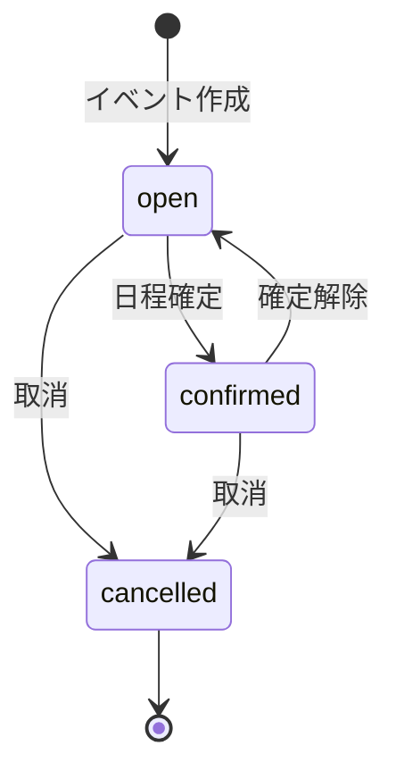

# vacaro-back API設計書

## 1. 目的

本書は、vacaro-backが提供するHTTP APIの契約を定義する。対象は日程調整イベントの作成、参加、参加可能時間の回答、候補日時の確認、日時確定、および将来のGoogle認証・Googleカレンダー連携である。

DB構造と制約については[データベース設計書](database-design.md)を参照する。

## 2. API基本方針

| 項目 | 方針 |
|---|---|
| プロトコル | HTTPS。本番環境ではHTTPを受け付けない |
| API形式 | JSONを使用するREST API |
| ベースパス | `/api/v1` |
| Content-Type | `application/json; charset=utf-8` |
| 日時形式 | RFC 3339。APIではUTCの`Z`表記を基本とする |
| ID形式 | UUID文字列 |
| JSON命名 | `snake_case` |
| 時間区間 | 開始を含み終了を含まない`[start_at, end_at)` |
| 認証 | HttpOnly Cookieによるセッション |
| 文字コード | UTF-8 |

クライアントはイベントの`time_zone`を使って日時を表示する。APIへ送信された日時はUTCへ正規化してDBへ保存する。

## 3. 実装フェーズ

### Phase 1: MVP

- ゲストセッション
- イベント作成・取得・更新・取消
- 招待URLによるイベント参加
- 参加者一覧
- 参加可能時間の登録・取得
- 共通候補日時の計算
- 日程確定

### Phase 2: Google連携

- Googleログイン
- ゲストユーザーからGoogleユーザーへの昇格
- Googleカレンダー連携・解除
- Googleカレンダーを使った参加可能時間の作成支援

## 4. 認証とセッション

### 4.1 MVPの方式

MVPでは、サーバーが署名・暗号化したセッションCookieを使用する。Cookieには最低限、ユーザーID、アカウント種別、有効期限を含める。

```text
Cookie: vacaro_session=<encrypted value>
```

Cookie属性：

- `HttpOnly`
- `Secure`（本番環境）
- `SameSite=Lax`
- `Path=/`
- ゲストセッションの有効期限と`users.guest_expires_at`を一致させる

MVPではフロントエンドとAPIを同一サイト配下へ配置する。別サイト構成にする場合は、CORS、`SameSite=None`、CSRF対策を別途設計する。

署名鍵は環境変数へ直接埋め込まず、デプロイ環境のSecret Managerから供給する。ログアウトはCookieを失効させる。サーバー側からの即時失効や複数端末のセッション管理が必要になった場合は、`sessions`テーブルを追加する。

### 4.2 CSRF対策

- 状態を変更するリクエストでは`Origin`ヘッダーを検証する。
- Cookieの`SameSite=Lax`を有効にする。
- クロスサイト構成へ変更する場合はCSRFトークンを追加する。
- `GET`と`HEAD`では状態を変更しない。

### 4.3 Google認証

Google認証ではAuthorization Code Flowを使用する。コールバックでは`state`と`nonce`を検証し、Googleの`sub`を`auth_accounts.provider_subject`として扱う。メールアドレスだけでユーザーを同一視しない。

Googleカレンダー権限はログイン権限と分け、利用者がカレンダー連携を選択したときだけ要求する。

## 5. 共通レスポンス

### 5.1 成功レスポンス

単一リソース：

```json
{
  "data": {
    "id": "0198d540-45b8-7f91-9fa8-4d7a455b1022"
  }
}
```

一覧：

```json
{
  "data": [],
  "meta": {
    "next_cursor": null
  }
}
```

削除やCookie破棄など、返却データがない場合は`204 No Content`を返す。

### 5.2 エラーレスポンス

```json
{
  "error": {
    "code": "validation_failed",
    "message": "入力内容を確認してください",
    "fields": {
      "window_end_at": "window_start_atより後を指定してください"
    },
    "request_id": "01J8E7JH0G5P5NQ4R6Y2K8C9AX"
  }
}
```

本番環境ではSQL、スタックトレース、OAuthトークン、招待トークンなどの内部情報をレスポンスへ含めない。

### 5.3 ステータスコード

| Status | 用途 |
|---:|---|
| `200 OK` | 取得・更新成功 |
| `201 Created` | リソース作成成功 |
| `204 No Content` | 取消・ログアウト成功 |
| `400 Bad Request` | JSON形式、日時形式などが不正 |
| `401 Unauthorized` | セッションがない、無効、期限切れ |
| `403 Forbidden` | 認証済みだが操作権限がない |
| `404 Not Found` | リソースがない、または存在を秘匿する |
| `409 Conflict` | 重複参加、時間帯重複、不正な状態遷移 |
| `422 Unprocessable Content` | JSONは正しいが業務ルールに違反 |
| `429 Too Many Requests` | レート制限超過 |
| `500 Internal Server Error` | 予期しないサーバーエラー |
| `503 Service Unavailable` | DBなど依存サービスを利用できない |

主なエラーコード：

- `invalid_json`
- `validation_failed`
- `authentication_required`
- `invalid_session`
- `permission_denied`
- `resource_not_found`
- `already_joined`
- `availability_overlap`
- `event_not_open`
- `invalid_event_transition`
- `database_unavailable`
- `internal_error`

## 6. リソース表現

### 6.1 User

```json
{
  "id": "0198d540-45b8-7f91-9fa8-4d7a455b1022",
  "account_type": "guest",
  "display_name": "田中",
  "email": null,
  "guest_expires_at": "2026-09-10T03:00:00Z",
  "created_at": "2026-09-03T03:00:00Z",
  "updated_at": "2026-09-03T03:00:00Z"
}
```

他ユーザーへ返す場合、`email`と`guest_expires_at`は含めない。

### 6.2 Event

```json
{
  "id": "0198d543-e7f0-7df2-95fa-cee649624cef",
  "title": "開発ミーティング",
  "description": "次回リリースについて相談します",
  "time_zone": "Asia/Tokyo",
  "window_start_at": "2026-09-10T00:00:00Z",
  "window_end_at": "2026-09-12T12:00:00Z",
  "duration_minutes": 60,
  "status": "open",
  "confirmed_start_at": null,
  "confirmed_end_at": null,
  "response_deadline_at": "2026-09-09T12:00:00Z",
  "created_at": "2026-09-03T03:00:00Z",
  "updated_at": "2026-09-03T03:00:00Z"
}
```

`invite_token`と`invite_url`はイベント作成時またはトークン再発行時に限り、主催者へ返す。DBに保存するのは`invite_token_hash`であるため、通常のイベント取得APIから生のトークンを再取得することはできない。

### 6.3 Participant

```json
{
  "id": "0198d545-6200-7973-8609-ab29d9ab461a",
  "user_id": "0198d540-45b8-7f91-9fa8-4d7a455b1022",
  "display_name": "田中",
  "role": "member",
  "response_status": "submitted",
  "created_at": "2026-09-03T03:10:00Z",
  "updated_at": "2026-09-03T03:20:00Z"
}
```

### 6.4 AvailabilityInterval

```json
{
  "id": "0198d547-3c18-76ee-b85c-e99897199aef",
  "start_at": "2026-09-10T01:00:00Z",
  "end_at": "2026-09-10T03:00:00Z",
  "source": "manual",
  "created_at": "2026-09-03T03:20:00Z",
  "updated_at": "2026-09-03T03:20:00Z"
}
```

## 7. エンドポイント一覧

### 7.1 システム

| Method | Path | 認証 | 説明 |
|---|---|---|---|
| `GET` | `/health` | 不要 | APIプロセスの生存確認 |
| `GET` | `/ready` | 不要 | DBを含む受付可能状態の確認 |

システム用エンドポイントには`/api/v1`を付けない。

### 7.2 セッション・ユーザー

| Method | Path | 認証 | 説明 |
|---|---|---|---|
| `POST` | `/api/v1/guest-sessions` | 不要 | ゲストユーザーとセッションを作成 |
| `GET` | `/api/v1/me` | 必要 | 自分のユーザー情報を取得 |
| `PATCH` | `/api/v1/me` | 必要 | 自分の表示名を変更 |
| `DELETE` | `/api/v1/session` | 必要 | ログアウト |

### 7.3 イベント

| Method | Path | 認証 | 説明 |
|---|---|---|---|
| `POST` | `/api/v1/events` | 必要 | イベントと主催者参加情報を作成 |
| `GET` | `/api/v1/events` | 必要 | 自分が参加しているイベント一覧 |
| `GET` | `/api/v1/events/{event_id}` | 参加者 | イベント詳細を取得 |
| `PATCH` | `/api/v1/events/{event_id}` | 主催者 | 未確定イベントの内容を変更 |
| `DELETE` | `/api/v1/events/{event_id}` | 主催者 | イベントを取消状態に変更 |
| `POST` | `/api/v1/events/{event_id}/invite-token` | 主催者 | 招待トークンを再発行 |
| `PUT` | `/api/v1/events/{event_id}/confirmation` | 主催者 | 日程を確定 |
| `DELETE` | `/api/v1/events/{event_id}/confirmation` | 主催者 | 確定を解除して受付中へ戻す |

### 7.4 招待・参加者

| Method | Path | 認証 | 説明 |
|---|---|---|---|
| `GET` | `/api/v1/invitations/{invite_token}` | 不要 | 招待先イベントの公開情報を取得 |
| `POST` | `/api/v1/invitations/{invite_token}/participants` | 必要 | 現在のユーザーとして参加 |
| `GET` | `/api/v1/events/{event_id}/participants` | 参加者 | 参加者一覧を取得 |
| `DELETE` | `/api/v1/events/{event_id}/participants/me` | 一般参加者 | イベントから退出 |

### 7.5 参加可能時間・候補

| Method | Path | 認証 | 説明 |
|---|---|---|---|
| `GET` | `/api/v1/events/{event_id}/my-availability` | 参加者 | 自分の参加可能時間を取得 |
| `PUT` | `/api/v1/events/{event_id}/my-availability` | 参加者 | 自分の参加可能時間を一括置換 |
| `GET` | `/api/v1/events/{event_id}/availability` | 参加者 | 全参加者の回答を取得 |
| `GET` | `/api/v1/events/{event_id}/candidates` | 参加者 | 共通候補日時を計算して取得 |

### 7.6 Google連携（Phase 2）

| Method | Path | 認証 | 説明 |
|---|---|---|---|
| `GET` | `/api/v1/auth/google/start` | 不要 | Google認証を開始 |
| `GET` | `/api/v1/auth/google/callback` | 不要 | Google認証コールバック |
| `POST` | `/api/v1/integrations/google-calendar` | Google認証 | カレンダー連携を開始 |
| `GET` | `/api/v1/integrations/google-calendar/callback` | Google認証 | カレンダー認可コールバック |
| `DELETE` | `/api/v1/integrations/google-calendar` | Google認証 | カレンダー連携を解除 |
| `POST` | `/api/v1/events/{event_id}/google-calendar-availability/preview` | 参加者・連携済み | カレンダーから空き時間候補を計算 |

Googleカレンダーから得た予定のタイトル、説明、参加者などはAPIレスポンスへ含めない。

## 8. 主要エンドポイント詳細

### 8.1 ゲストセッション作成

```http
POST /api/v1/guest-sessions
```

Request：

```json
{
  "display_name": "田中"
}
```

処理：

1. `users`へ`account_type = guest`として登録する。
2. `guest_expires_at`を設定する。
3. 暗号化されたセッションCookieを発行する。
4. `201 Created`でユーザー情報を返す。

入力制約：

- `display_name`: 前後の空白を除いて1～100文字

### 8.2 イベント作成

```http
POST /api/v1/events
```

Request：

```json
{
  "title": "開発ミーティング",
  "description": "次回リリースについて相談します",
  "time_zone": "Asia/Tokyo",
  "window_start_at": "2026-09-10T00:00:00Z",
  "window_end_at": "2026-09-12T12:00:00Z",
  "duration_minutes": 60,
  "response_deadline_at": "2026-09-09T12:00:00Z"
}
```

Response：`201 Created`

```json
{
  "data": {
    "id": "0198d543-e7f0-7df2-95fa-cee649624cef",
    "title": "開発ミーティング",
    "status": "open",
    "invite_token": "<random-token>",
    "invite_url": "https://vacaro.example/invitations/<random-token>"
  }
}
```

処理は1トランザクションとする。

1. 暗号学的に安全な招待トークンを生成する。
2. SHA-256ハッシュを`events.invite_token_hash`へ保存する。
3. イベントを作成する。
4. 現在のユーザーを`role = organizer`として`participants`へ追加する。

生の招待トークンを紛失した場合は`POST /api/v1/events/{event_id}/invite-token`で再発行する。再発行後は以前の招待トークンを直ちに無効とする。

入力制約：

- `title`: 1～200文字
- `description`: 最大5,000文字
- `time_zone`: 有効なIANAタイムゾーン
- `window_start_at < window_end_at`
- `duration_minutes`: 5～1,440分
- `duration_minutes`はイベント期間以下
- `response_deadline_at`を指定する場合は`window_end_at`以前

### 8.3 招待情報取得

```http
GET /api/v1/invitations/{invite_token}
```

未認証でも取得できる情報：

- タイトル
- 説明
- 表示タイムゾーン
- 回答対象期間
- 必要時間
- ステータス
- 回答期限

参加者名、参加可能時間、ユーザーID、主催者のメールアドレスは返さない。無効または取消済みのトークンには`404 Not Found`を返す。

### 8.4 イベント参加

```http
POST /api/v1/invitations/{invite_token}/participants
```

Request：

```json
{
  "display_name": "田中"
}
```

現在のユーザーを`participants`へ追加する。既に参加済みの場合は`409 already_joined`を返す。イベントが`open`でない場合は`409 event_not_open`を返す。

未認証の場合、クライアントは先に`POST /api/v1/guest-sessions`を呼び出す。

### 8.5 参加可能時間の一括更新

```http
PUT /api/v1/events/{event_id}/my-availability
```

Request：

```json
{
  "intervals": [
    {
      "start_at": "2026-09-10T01:00:00Z",
      "end_at": "2026-09-10T03:00:00Z"
    },
    {
      "start_at": "2026-09-10T05:00:00Z",
      "end_at": "2026-09-10T07:00:00Z"
    }
  ]
}
```

処理：

1. イベントまたは参加者を`SELECT ... FOR UPDATE`でロックする。
2. イベントが`open`か検証する。
3. 各区間がイベント期間内か検証する。
4. 区間を開始日時順へ並べる。
5. 重複区間を拒否し、隣接区間を統合する。
6. 既存区間を削除して新しい区間を登録する。
7. `participants.response_status`を`submitted`へ変更する。

上記全体を1トランザクションで実行する。空配列は「参加可能時間なし」という回答として受け付け、`response_status`は`submitted`とする。1回の更新は最大100区間とする。

Response：`200 OK`

```json
{
  "data": {
    "response_status": "submitted",
    "intervals": []
  }
}
```

### 8.6 候補日時取得

```http
GET /api/v1/events/{event_id}/candidates?limit=20
```

イベントの`duration_minutes`を満たす時間帯を、参加可能人数の多い順に返す。同数の場合は開始日時の早い順とする。

Response：`200 OK`

```json
{
  "data": [
    {
      "start_at": "2026-09-10T01:00:00Z",
      "end_at": "2026-09-10T02:00:00Z",
      "available_participant_count": 4,
      "total_participant_count": 5,
      "available_participant_ids": [
        "0198d545-6200-7973-8609-ab29d9ab461a"
      ]
    }
  ],
  "meta": {
    "limit": 20
  }
}
```

候補は初期段階ではDBへ保存せず、`availability_intervals`から都度計算する。未回答者は参加不可として人数に含めないが、`total_participant_count`には含める。

### 8.7 日程確定

```http
PUT /api/v1/events/{event_id}/confirmation
```

Request：

```json
{
  "start_at": "2026-09-10T01:00:00Z",
  "end_at": "2026-09-10T02:00:00Z"
}
```

入力日時はイベント期間内で、`end_at - start_at`が`duration_minutes`と一致しなければならない。候補一覧にない日時でも、主催者がイベント期間内で選択した場合は確定可能とする。

成功時はイベントを`confirmed`へ変更して`200 OK`を返す。同時更新を防ぐため、更新前にイベント行をロックする。

### 8.8 イベント取消

```http
DELETE /api/v1/events/{event_id}
```

物理削除せず`status = cancelled`へ変更し、`204 No Content`を返す。同じリクエストを再度実行しても`204`とする。取消済みイベントへの回答・確定・参加は拒否する。

## 9. イベント状態遷移



| 現在 | 操作 | 次の状態 | 許可 |
|---|---|---|---|
| `open` | 回答・参加・内容変更 | `open` | 可 |
| `open` | 確定 | `confirmed` | 主催者のみ |
| `open` | 取消 | `cancelled` | 主催者のみ |
| `confirmed` | 確定解除 | `open` | 主催者のみ |
| `confirmed` | 取消 | `cancelled` | 主催者のみ |
| `confirmed` | 回答・参加 | - | 不可 |
| `cancelled` | 任意の変更 | - | 不可 |

DB制約上、`confirmed`以外の状態では`confirmed_start_at`と`confirmed_end_at`をNULLにする。確定解除・取消と同じUPDATE内で両カラムをNULLへ戻す。

## 10. 権限

| 操作 | 未認証 | 招待URL保有者 | 一般参加者 | 主催者 |
|---|---:|---:|---:|---:|
| 公開招待情報の取得 | 可 | 可 | 可 | 可 |
| イベント参加 | 不可 | 認証後可 | - | - |
| イベント詳細の取得 | 不可 | 不可 | 可 | 可 |
| 参加者・回答の取得 | 不可 | 不可 | 可 | 可 |
| 自分の回答更新 | 不可 | 不可 | 可 | 可 |
| イベント内容変更 | 不可 | 不可 | 不可 | 可 |
| 招待トークン再発行 | 不可 | 不可 | 不可 | 可 |
| 日程確定・取消 | 不可 | 不可 | 不可 | 可 |

イベントIDを知っているだけではアクセスを許可しない。参加者向けAPIでは、現在のユーザーが対象イベントの`participants`に存在するか確認する。

## 11. 一覧とページネーション

イベント一覧はカーソル方式を使用する。

```http
GET /api/v1/events?status=open&limit=20&cursor=<opaque-cursor>
```

- `limit`: デフォルト20、最大100
- `cursor`: サーバーが生成した不透明な文字列
- 並び順：`created_at DESC, id DESC`
- クライアントはカーソルの内容を解釈・生成しない

参加者と参加可能時間は、MVPではイベント単位の件数上限を設け、ページネーションなしで返す。上限を超える利用要件が生じた場合にカーソル方式を追加する。

## 12. 入力検証

- リクエストボディの上限を1 MiBとする。
- 未知のJSONフィールドは`400 invalid_json`として拒否する。
- JSONオブジェクトの後に別のJSON値が続く入力を拒否する。
- 文字列は前後の空白を除去してから長さを検証する。
- UUID、RFC 3339日時、IANAタイムゾーンを厳密に検証する。
- 参加可能時間はイベント期間内に限定する。
- DB制約違反は内部エラーにせず、判別可能なものを`409`または`422`へ変換する。

## 13. セキュリティ・運用

- 招待トークン、Cookie、Authorization Code、OAuth Tokenをログへ出さない。
- 招待トークンを含むURLのアクセスログはマスクする。
- Google OAuthのリダイレクト先は許可リストで検証する。
- エラーにはリクエストIDを付け、同じIDを構造化ログへ記録する。
- APIサーバーではRead Header、Request Body、Idle、Shutdownのタイムアウトを設定する。
- 状態変更APIにはユーザー単位とIP単位のレート制限を適用する。
- DBクエリにはリクエストの`context.Context`を伝播する。
- `GET /health`はDBへアクセスせず、`GET /ready`だけがDB接続を確認する。

## 14. 実装単位

APIは次の順番で実装する。

1. 共通JSONレスポンスとエラー処理
2. リクエストID・アクセスログ・パニック復旧ミドルウェア
3. ゲストセッション作成と認証ミドルウェア
4. イベント作成と主催者参加情報の同時登録
5. 招待情報取得とイベント参加
6. 参加可能時間の一括更新
7. 参加者別回答と候補日時の取得
8. 日程確定・確定解除・取消
9. Google認証とカレンダー連携

各機能はHandler、Service、Repositoryに分離し、Service層のテストではRepositoryをインターフェースで差し替える。RepositoryのSQLは`sqlc`で型安全なGoコードへ生成する。

## 15. 未確定事項

- ゲストセッションの具体的な有効期間
- イベントおよび参加者数の上限
- 参加者同士に個別の参加可能時間を公開するか、集計結果だけ公開するか
- イベント確定・取消時のメール通知方法
- 回答期限後に主催者が回答を再開できるか
- Googleカレンダーから空き時間を計算するときの営業時間・休日設定
- OpenAPI定義からサーバー型を生成するか、実装後にOpenAPIを生成するか
